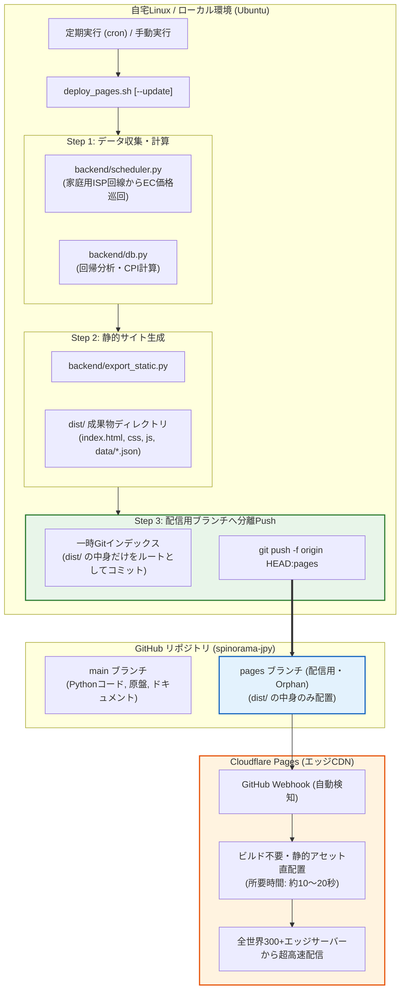

# Cloudflare Pages GitHub連携（パターンB: 配信用ブランチ分離方式）完全設計・運用ガイド

---

## 1. 背景と採用理由

### 1.1 なぜGitHub連携へ移行するのか？
従来はローカル環境から CLI ツール（Wrangler）を用いて直接 Cloudflare Pages へアップロード（`wrangler pages deploy`）していました。しかし、以下の課題が生じています：
- **Wranglerの段階的廃止**: Cloudflareは2026年9月に次世代CLI「`cf`」を発表し、WranglerのEOL（保守終了・廃止）ロードマップを公開しました。
- **CLI依存によるメンテナンス負荷**: CLIのメジャーアップデート、Node.jsバージョン要件の変更、ローカル認証トークンの期限切れなどの影響を定期的に受けます。

**GitHub連携方式を採用することで、ローカル環境のCLIツール（Wranglerや`cf`）への依存が「ゼロ」**になり、Gitさえあれば永久に安定してデプロイできるようになります。

### 1.2 なぜ「パターンB（配信用専用ブランチ分離方式）」なのか？
GitHub連携を行う場合、単に `main` ブランチに生成物（`dist/`）をコミットすると以下の問題が発生します：
- 毎週の価格巡回・計算によって大量のJSON差分が発生し、Gitのコミット履歴がデータ更新ログで埋め尽くされる。
- リポジトリの容量（`.git`）が急速に肥大化し、cloneやpushが重くなる。

**パターンBのメリット**:
- **ソースコード用（`main`）** と **配信用成果物（`pages`）** のブランチを完全に分離。
- 配信用ブランチは「常に最新スナップショットを強制上書き（`-f`）」でプッシュするため、何年運用してもGitHubリポジトリの容量が増加しない。
- 手元の `main` ブランチの作業ツリーを切り替えることなく、スクリプトがバックグラウンドで瞬時にプッシュを完了する。

---

## 2. 全体アーキテクチャとデータフロー



> [!IMPORTANT]
> **自宅Linuxで価格巡回を行う理由**:
> Amazon.co.jpや国内ECサイトは、CloudflareやGitHub Actions等のデータセンターIPからのアクセスを厳格に拒否（403/CAPTCHA）します。家庭用プロバイダIPを持つ自宅環境で巡回・計算し、成果物のみをGitHub経由でエッジに送る構成が必須となります。

---

## 3. スマートPush方式の技術的仕組み

### 従来手法との比較

| 方式 | 仕組み | メリット | デメリット |
| :--- | :--- | :--- | :--- |
| **通常コミット方式** | `dist/` を `main` ブランチにコミットしてPush | 設定が単純 | 毎週のJSON変更でGit履歴が汚染され、リポジトリが肥大化する |
| **ブランチ切替方式** | `git checkout pages` してファイルをコピーしてPush | ブランチは分離される | 作業中の未コミット変更があると衝突・失敗する。動作が遅い |
| **スマートPush方式 (採用)** | `dist/` ディレクトリ内で一時的に最新コミットを作成し、リモートの `pages` ブランチに強制上書きプッシュ（`-f`） | **作業ツリー不干渉、リポジトリ肥大化ゼロ、超高速** | なし |

### スクリプト内部で実行される具体的なGit処理
```bash
# 1. dist/ ディレクトリに移動
cd dist

# 2. 一時的なGit管理環境を作成（親リポジトリとは独立）
git init -b pages
git config user.name "Deploy Bot"
git config user.email "deploy@spinorama.local"

# 3. dist/ の全ファイルを追加してコミット
git add -A
git commit -m "Auto-deploy: $(date '+%Y-%m-%d %H:%M:%S')"

# 4. リモートリポジトリの pages ブランチへ強制上書きプッシュ
git push -f "$REMOTE_URL" pages

# 5. 一時的な .git フォルダをクリーンアップ
rm -rf .git
```
この方式により、親リポジトリの履歴には配信用データが一切混入せず、GitHub上の `pages` ブランチは常に「最新の公開用静的ファイル群」だけが保持されます。

---

## 4. 具体的な導入手順（5ステップ）

### 【ステップ 1】ローカルGitの初期設定と `.gitignore` の整備

まず、巨大なデータベースファイル（`data/*.db`）やキャッシュが誤ってGitに入らないよう、プロジェクトルートに `.gitignore` を配置します。

#### `.gitignore` の内容
```gitignore
# データベース本体・WALファイル
data/*.db
data/*.db-wal
data/*.db-shm

# ログファイル
*.log
data/*.log

# 静的生成ディレクトリ（成果物は pages ブランチに直接送るため除外）
dist/

# Pythonキャッシュ
__pycache__/
*.pyc

# 旧Wranglerキャッシュ
.wrangler/
```

#### 初期コミットの作成
```bash
cd /home/nari/scripts/spinorama_JPY
git init -b main
git add .
git commit -m "Initial commit: spinorama_JPY core source code"
```

---

### 【ステップ 2】GitHubリポジトリの作成と接続

1. ブラウザで [GitHub](https://github.com/new) を開き、新しいリポジトリを作成します。
   - **Repository name**: `spinorama-jpy`（または任意）
   - **Visibility**: `Public` または `Private`
   - **README / .gitignore の初期化チェック**: **外す**（空のリポジトリにする）
2. ローカルリポジトリにリモート（`origin`）を登録し、初回プッシュを行います：
   ```bash
   # SSHの場合（推奨）
   git remote add origin git@github.com:<あなたのユーザー名>/spinorama-jpy.git
   
   # HTTPSの場合
   # git remote add origin https://github.com/<あなたのユーザー名>/spinorama-jpy.git
   
   # main ブランチをプッシュ
   git push -u origin main
   ```

---

### 【ステップ 3】初回の配信用ブランチ（`pages`）の作成

Cloudflare Pagesが認識できるように、初回のみ `pages` ブランチをリモートに作成します。
静的ファイルを生成してプッシュします：

```bash
# 静的ファイルを生成
python3 backend/export_static.py

# dist/ の中身を pages ブランチとしてプッシュ
cd dist
git init -b pages
git add -A
git commit -m "Initial pages release"
git remote add origin $(git -C .. config --get remote.origin.url)
git push -u -f origin pages
rm -rf .git
cd ..
```
これでGitHub上に `main`（ソースコード）と `pages`（公開用静的ファイル）の2つのブランチが揃います。

---

### 【ステップ 4】Cloudflare Pages 側の設定（GUIで1回のみ）

Cloudflareダッシュボードでリポジトリと接続します。

1. [Cloudflare ダッシュボード](https://dash.cloudflare.com/) にログイン
2. 左メニューの **「Workers & Pages」** ➔ **「概要」** ➔ **「作成」** をクリック
3. タブから **「Pages」** ➔ **「Git に接続」** を選択
4. お使いのGitHubアカウントを連携し、リポジトリ **`spinorama-jpy`** を選択
5. **ビルド設定（Set up builds）**:
   - **プロジェクト名**: `spinorama-jpy`
   - **本番ブランチ (Production branch)**: **`pages`** を選択
   - **フレームワークのプリセット (Framework preset)**: **`None`**（なし）
   - **ビルドコマンド (Build command)**: **空欄**（何も入力しない）
   - **ビルド出力ディレクトリ (Build output directory)**: **`/`**（または空欄）
6. **「保存してデプロイ」** をクリック

> [!NOTE]
> ビルドコマンドを空欄にする理由：
> 自宅Linux側ですでにHTML/CSS/JS/JSONの完全な静的サイトを生成済みであるため、Cloudflare側でビルド処理を行う必要がありません。そのままエッジに配置されるため、デプロイが数十秒で完了します。

---

### 【ステップ 5】自動デプロイスクリプトの改修 (`deploy_pages.sh`)

`deploy_pages.sh` を改修し、Wranglerの代わりにスマートPushを実行するようにします。

```bash
#!/bin/bash
set -e

SCRIPT_DIR="$(cd "$(dirname "${BASH_SOURCE[0]}")" && pwd)"
cd "$SCRIPT_DIR"

echo "========================================================"
echo " SPINORAMA JPY -> Cloudflare Pages (GitHub連動デプロイ)"
echo "========================================================"

# リモートリポジトリURLの取得
REMOTE_URL=$(git config --get remote.origin.url || true)
if [ -z "$REMOTE_URL" ]; then
    echo "【エラー】Gitのリモート(origin)が設定されていません。"
    echo "git remote add origin <GitHub_URL> を実行してください。"
    exit 1
fi

# 1. オプション: --update が指定されたら価格巡回・計算を実行
if [[ "$1" == "--update" ]]; then
    echo ">>> [1/3] 最新データ巡回とコストパフォーマンス再計算を実行中..."
    python3 backend/scheduler.py --now
else
    echo ">>> [1/3] 既存データベースから静的エクスポートを行います..."
    echo "    (価格巡回も同時に行う場合は: ./deploy_pages.sh --update)"
fi

# 2. 静的サイト生成 (dist/ ディレクトリの構築)
echo ">>> [2/3] 静的ファイル (dist/) を生成中..."
python3 backend/export_static.py

# 3. 配信用ブランチ (pages) へスマートPush
echo ">>> [3/3] GitHub (pages ブランチ) へ成果物をPush中..."
DEPLOY_TIME=$(date '+%Y-%m-%d %H:%M:%S')

(
    cd dist
    rm -rf .git
    git init -b pages > /dev/null
    git config user.name "Spinorama Deployer"
    git config user.email "deploy@spinorama.local"
    git add -A
    git commit -m "Auto-deploy: ${DEPLOY_TIME}" > /dev/null
    git push -f "$REMOTE_URL" pages > /dev/null 2>&1
    rm -rf .git
)

echo "========================================================"
echo " GitHubへのPushが完了しました！"
echo " Cloudflare Pagesが自動検知し、数秒でエッジに反映されます。"
echo "========================================================"
```

---

## 5. 日常の運用手順

### 通常の週次更新（コマンド1発）
```bash
./deploy_pages.sh --update
```
- 価格巡回 ➔ スコア再計算 ➔ 静的生成 ➔ GitHub `pages` ブランチへPush ➔ Cloudflare自動デプロイ が全自動で走ります。

### 手動修正後の即時反映
Web UI（`backend/app.py`）で価格や手動フラグを編集した後、即座にサイトへ反映させたい場合：
```bash
./deploy_pages.sh
```
- 価格巡回をスキップし、数秒で静的生成＆デプロイが完了します。

### 完全自動化（Hermes Agent スケジューラーによる週次実行）
本システムは Linux の crontab ではなく、AI常駐デーモン **「Hermes Agent」の内蔵cronスケジューラー（`~/.hermes/cron/jobs.json`）** により、毎週土曜日に完全自動で2便体制のパイプラインを実行しています：

- **第1便（土曜 09:00 JST / ジョブID: `c98e4ba32075`）**:
  - 全スピーカーの最新価格巡回 ➔ CPI再計算 ➔ 静的生成 ➔ `scripts/weekly_deploy.sh` による自動Push
- **第2便（土曜 10:00 JST / ジョブID: `645caad4e7e2`）**:
  - DeepSeek AIエージェント（`deepseek-v4-flash`）が未検証上位10件をWeb自律調査・DB反映 ➔ 再デプロイ ➔ Telegram通知

手動で今すぐパイプラインを実行したい場合：
```bash
bash scripts/weekly_pipeline.sh
```

---

## 6. トラブルシューティングとFAQ

### Q1. GitHubへのPushでパスワードやトークンを毎回聞かれる / 失敗する
- **解決策**: SSHキーを設定するか、GitのCredential Helper（認証情報キャッシュ）を有効化します。
  - SSHの場合: `ssh -T git@github.com` で `Hi <username>!` と表示されることを確認。
  - HTTPSの場合: Personal Access Token（classic、`repo` 権限あり）を生成して保存。

### Q2. Cloudflare Pagesのビルドが失敗する
- **確認点**: Cloudflareダッシュボードの「ビルド設定」で、**ビルドコマンドが「空欄」**、**出力ディレクトリが「`/`」**、**本番ブランチが「`pages`」** になっているか確認してください。

### Q3. 過去のデータにロールバックしたい場合は？
- Cloudflareダッシュボードの **「Deployments（デプロイ履歴）」** から、過去のデプロイを選択して「Rollback to this deployment」をクリックするだけで、1クリックで過去バージョンに即時復元できます。
