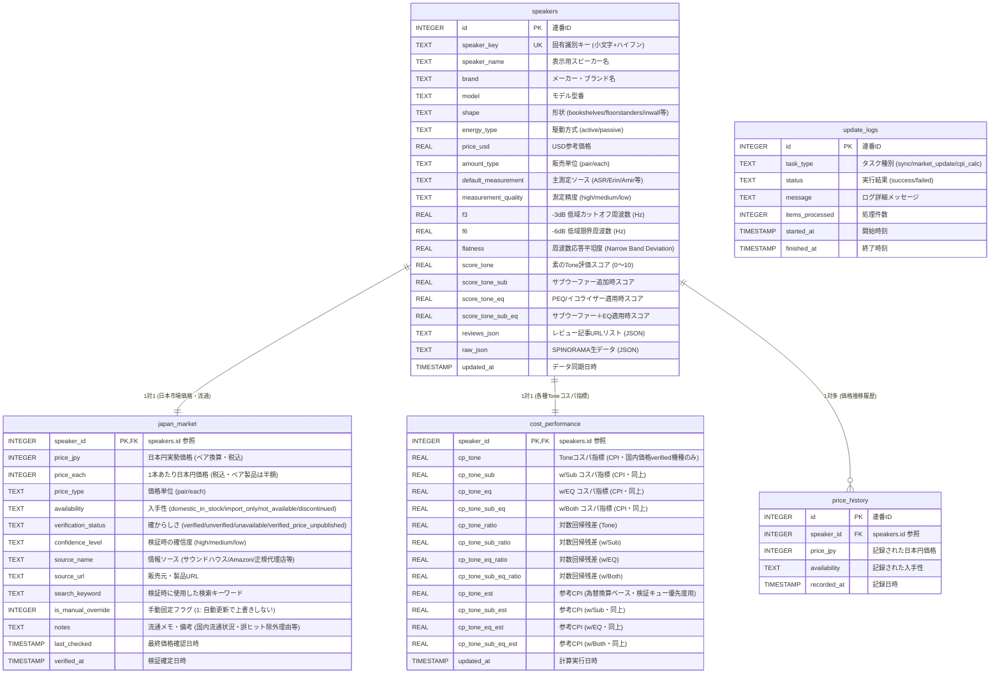

# SPINORAMA JPY - スピーカー測定＆日本円コスパ分析システム

SPINORAMA公式 ([spinorama.org/scores.html](https://www.spinorama.org/scores.html)) のスピーカー音響測定データに、**日本円（JPY）実勢価格**および**日本市場での入手性（国内正規品・並行輸入・ディスコン等）**の情報を補完したデータベース＆Webダッシュボードです。

「Tone」「Tone w/SUB」「Tone w/EQ」「Tone w/SUB and EQ」の4種類の音響評価スコアそれぞれに対し、価格との関係から**コストパフォーマンスの昇順/降順ソート・散布図分析**が可能です。また、日本市場情報は**週1回ペースで自動更新・蓄積**されます。

---

## 主な機能と特徴

1. **SPINORAMA scores.html 準拠の完全なデータテーブル**:
   - `Brand Model`, `USD`, `Reviews (ASR/Erin等)`, `-3dB (低域限界)`, `Flat. (平坦度)`, `Tone`, `w/sub`, `w/eq`, `w/both`
   - **本システム独自カラム**: `JPY 実勢価格 (ペア換算)`, `入手性バッジ`, `Tone各種コスパ指標 (CPI)`
2. **直観的かつ実用的なコストパフォーマンス指標 (CPI)**:
   - **CPI算出式**: $\text{CPI} = \frac{\text{Score} - \text{Base}}{\sqrt{\text{Price(JPY)} / 10,000}}$
   - **順位表示は「国内価格が検証済み（`verified`）の機種のみ」**。為替換算などの推定値しか持たない未検証機種は CPI を `NULL` とし、順位表には載せません。
3. **インタラクティブ散布図（価格 vs スコア）**:
   - 横軸に対数価格、縦軸にスコアをプロット。
   - 期待値ライン（回帰直線）より上にある機種ほど高コスパ。プロットをクリックしてその場で編集可能。
4. **日本市場価格・入手性の週次更新＆手動修正**:
   - サウンドハウス、Amazon、国内正規代理店の実勢価格・在庫ステータスを蓄積。
   - 誤ヒット防止機能（パーツ・ケーブル・カーオーディオ・自作DIYキットの自動除外）。
   - UI上からワンクリックで価格・入手性・メモを手動編集・固定可能（自動更新による上書きをロック）。
5. **日本市場価格 確からしさ検証スタジオ (Price Verification Studio) [NEW]**:
   - **検索アシスタント**: 機種名から最適な検索キーワード（`JBL 305P MkII ペア 価格` 等）を自動生成し、ワンクリックでコピー＆Google/価格.com/サウンドハウス/Amazon/ヨドバシを新規タブで一発検索。
   - **誤認防止入力**: 1本単価を入力して `[×2 (ペア換算)]` を押すだけでペア価格を自動計算。
   - **確からしさステータス管理**: `🟢 検証済み` / `🟡 要再確認` / `🔴 未検証` / `🚫 国内流通なし確定`
   - **調査優先度**: 検証キューは参考CPI（為替換算ベース・`cp_tone_est`）降順で並び、コスパ上位の機種から順に検証できます。参考CPIは順位表には使われません。
   - **高速検証ループ**: `Ctrl+Enter` または `[✅ 保存して次へ進む]` で次々に検証を進め、進捗率バーで達成状況を可視化。

---

```

## データベース構成 (Database Architecture)

SQLite3（`data/spinorama_jpy.db`）を採用。高頻度アクセスやWebアクセスとバックグラウンドバッチの同時実行に耐えるため、接続時に `PRAGMA journal_mode=WAL;` および `timeout=20.0` を適用しています。



### 手動修正（`is_manual_override`）の保護設計
ユーザーがWebダッシュボードから「日本入手不可」や価格を修正した場合、`is_manual_override = 1` が設定されます。以後の定期巡回や自動同期バッチでは、このフラグが `1` のレコードはスキップされ、**ユーザーの入力した判断が自動クローラーによって上書きされることはありません**。

### ランキング対象の定義（CPI算出ルール）

公開ランキング（一覧の「Toneコスパ」列とそのソート順位）は、**日本国内価格が検証済み（`verification_status = 'verified'` かつ `price_jpy` が存在）の機種のみ**を対象とします。

| 日本市場の状態 | 公開CPI（`cp_tone`系） | 順位表 |
|---|---|---|
| 国内価格が検証済み（`verified`） | 算出 | **表示** |
| 未検証（為替換算などの推定値のみ） | `NULL` | 非表示（`≈` の参考CPIのみ表示） |
| 国内流通なし・入手不可（`not_available`） | `NULL` | 非表示 |
| 価格非公開（`verified_price_unpublished`） | `NULL` | 非表示 |
| 生産完了・終売（`discontinued`） | `NULL` | 非表示 |

- **対数回帰直線（期待値ライン）**も確定価格（`verified`）の機種のみで再フィットします。為替換算値は回帰に混入しません。
- 未検証機種は為替換算ベースの**参考CPI（`cp_tone_est` / `cp_tone_sub_est` / `cp_tone_eq_est` / `cp_tone_sub_eq_est`）** を保持し、**Price Verification Studio の調査優先度**（`COALESCE(cp_tone, cp_tone_est)` 降順）にのみ使用します。これにより「日本価格が不明なのに上位に表示される」事象を排除しつつ、次に調べるべき順番は維持されます。
- **UI表記**: 一覧のCPIセルは未確定機種を `≈1.05`（淡色＋「国内価格が未確定のため順位対象外」ツールチップ）で表示、検証スタジオは `参考CPI: ≈1.05` と表示します。
- **`verification_status` の運用ルール**: 国内流通なしが確定した機種は `availability=not_available` ＋ `verification_status=unavailable`、終売が販売店・メーカーで確認できた機種は `availability=discontinued` ＋ `verification_status=verified`（いずれも `price_jpy=null`）とします。
- **販売単位の正規化**: 1本売りのアクティブモニター等は `price_each=1本税込価格`／`price_jpy=ペア換算（×2）`、ペア製品は `price_each=半額`／`price_jpy=ペア税込価格` に統一します。

---
  Web UI右上の「📥 CSV出力」ボタンをクリックすると、日本円価格・入手性・各種Toneコスパ値をすべて含んだCSVファイルがダウンロードされます。
