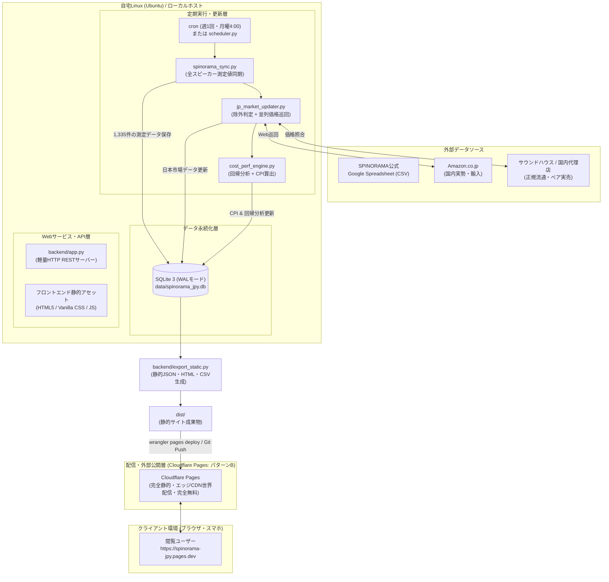
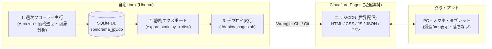
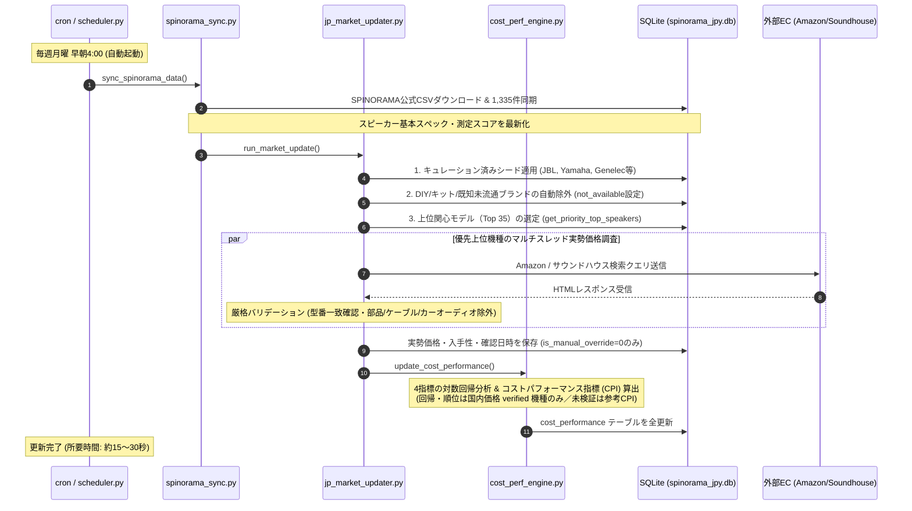

# SPINORAMA JPY - スピーカー測定＆日本円コスパ分析システム

SPINORAMA公式 ([spinorama.org/scores.html](https://www.spinorama.org/scores.html)) のスピーカー音響測定データに、**日本円（JPY）実勢価格**および**日本市場での入手性（国内正規品・並行輸入・ディスコン等）**の情報を補完したローカルデータベース＆Webダッシュボードです。

「Tone」「Tone w/SUB」「Tone w/EQ」「Tone w/SUB and EQ」の4種類の音響評価スコアそれぞれに対し、価格との関係から**コストパフォーマンスの昇順/降順ソート・散布図分析**が可能です。また、日本市場情報は**週1回ペースで自動更新・蓄積**され、UIから直接ワンクリックで手動修正・固定することもできます。

---

## 主な機能と特徴

1. **SPINORAMA scores.html 準拠の完全なデータテーブル**:
   - `Brand Model`, `USD`, `Reviews (ASR/Erin等)`, `-3dB (低域限界)`, `Flat. (平坦度)`, `Tone`, `w/sub`, `w/eq`, `w/both`
   - **本システム独自カラム**: `JPY 実勢価格 (ペア換算)`, `入手性バッジ`, `Tone各種コスパ指標 (CPI)`
2. **直観的かつ実用的なコストパフォーマンス指標 (CPI)**:
   - 高額スピーカー（数十万〜数百万）が過大評価される対数残差の欠点を解消し、低〜中価格帯（1万〜10万円台）で卓越した音質スコアを叩き出す真の高コスパ機を上位に配置。
   - **CPI算出式**: $\text{CPI} = \frac{\text{Score} - \text{Base}}{\sqrt{\text{Price(JPY)} / 10,000}}$
   - **順位表示は「国内価格が検証済み（`verified`）の機種のみ」**。為替換算などの推定値しか持たない未検証機種は CPI を `NULL` とし、順位表には載せません（推定値で順位を汚さない）。詳細は「[ランキング対象の定義](#ランキング対象の定義cpi算出ルール)」を参照。
3. **インタラクティブ散布図（価格 vs スコア）**:
   - 横軸に対数価格、縦軸にスコアをプロット。
   - 期待値ライン（回帰直線）より上にある機種ほど高コスパ。プロットをクリックしてその場で編集可能。
4. **日本市場価格・入手性の週次更新＆手動修正**:
   - サウンドハウス、Amazon、国内正規代理店の実勢価格・在庫ステータスを蓄積。
   - 誤ヒット防止機能（パーツ・ケーブル・カーオーディオ・自作DIYキットの自動除外）。
   - UI上からワンクリックで価格・入手性・メモを手動編集・固定可能（自動更新による上書きをロック）。
5. **日本市場価格 確からしさ検証スタジオ (Price Verification Studio) [NEW]**:
   - 為替換算や機械推定による誤認（1本売りとペア売りの混同、パーツ誤認、法外な輸入価格）を撲滅するための**人間検証特化ワークスペース**。
   - **検索アシスタント**: 機種名から最適な検索キーワード（`JBL 305P MkII ペア 価格` 等）を自動生成し、ワンクリックでコピー＆Google/価格.com/サウンドハウス/Amazon/ヨドバシを新規タブで一発検索。
   - **誤認防止入力**: 1本単価を入力して `[×2 (ペア換算)]` を押すだけでペア価格を自動計算。
   - **確からしさステータス管理**: `🟢 検証済み` / `🟡 要再確認` / `🔴 未検証` / `🚫 国内流通なし確定`
   - **調査優先度**: 検証キューは参考CPI（為替換算ベース・`cp_tone_est`）降順で並び、コスパ上位の機種から順に検証できます。参考CPIは順位表には使われません。
   - **高速検証ループ**: `Ctrl+Enter` または `[✅ 保存して次へ進む]` で次々に検証を進め、進捗率バーで達成状況を可視化。

---

# アーキテクチャ設計書 (Architecture Design)

## 1. 全体システム構成図



---

## 2. ネットワーク・運用アーキテクチャ (パターンB: 自宅Linux ＋ Cloudflare Pages)

本システムは、**「自宅Linux（Ubuntu）で価格調査・DB管理を行い、成果物を静的サイトとしてCloudflare Pagesに週次デプロイする」** 構成を標準運用モデルとして採用しています。



### 2.1 本構成（パターンB）が優れている理由

1. **スクレイピングの安定性（家庭用ISP回線）**:
   * Amazon.co.jpや国内ECサイトは、Cloudflare/AWS等のデータセンターIPを厳格に検知・拒否（CAPTCHA/403）します。家庭用ISP回線の自宅Linuxで巡回することで、安定した価格取得が可能です。
2. **世界最高峰の表示速度＆ダウンタイムゼロ**:
   * Cloudflare Pagesは全世界300都市以上のエッジサーバーから静的配信されるため、自宅サーバーの電源が落ちていても、回線が混雑していても、スマホから一瞬（TTFB数十ミリ秒）でランキングが表示されます。
3. **クライアントサイド超高速インメモリ検索**:
   * 全1,128機種のデータ（約150KB gzip）が初回にキャッシュされ、メーカー・価格・Toneスコア等の絞り込みやソートが**0ms（即時）**で動作します。
4. **安心の完全無料＆ノーメンテナンス**:
   * サーバーレス配信のため、自宅Linuxのポート開放（穴あけ）や固定IPは一切不要です。運用コスト・電気代も最小限で済みます。

---

## 3. デュアルモード対応（APIモード ⇄ 静的Pagesモード）

フロントエンド（`frontend/js/app.js`）は**環境を自動検知するハイブリッド設計**となっています：
* **ローカル開発・管理時 (`app.py` 実行時)**:
  * バックエンドAPI（`/api/speakers` 等）と通信し、Web画面からワンクリックで価格編集や「入手不可」の手動固定が可能。
* **Cloudflare Pages 公開時**:
  * APIサーバーがなくても自動で静的モード（`data/speakers.json`）にフォールバック。全機能（ソート・検索・散布図・CSVダウンロード）がスタンドアロンで完全動作します。
  * 編集モーダルは自動的に「閲覧専用モード」の案内を表示します。

---

## 3. データベース構成 (Database Architecture)

SQLite3（`data/spinorama_jpy.db`）を採用。高頻度アクセスやWebアクセスとバックグラウンドバッチの同時実行に耐えるため、接続時に `PRAGMA journal_mode=WAL;` および `timeout=20.0` を適用しています。


### 手動修正（`is_manual_override`）の保護設計
ユーザーがWebダッシュボードから「日本入手不可」や価格を修正した場合、`is_manual_override = 1` が設定されます。以後の定期巡回や自動同期バッチでは、このフラグが `1` のレコードはスキップされ、**ユーザーの入力した判断が自動クローラーによって上書きされることはありません**。

### ランキング対象の定義（CPI算出ルール）

公開ランキング（一覧の「Toneコスパ」列とそのソート順位）は、**日本国内価格が検証済み（`verification_status = 'verified'` かつ `price_jpy` が存在）の機種のみ**を対象とします。

| 日本市場の状態 | 公開CPI（`cp_tone`系） | 順位表 |
|---|---|---|
| 国内価格が検証済み（`verified`） | 算出 | **表示** |
| 未検証（為替換算などの推定値のみ） | `NULL` | 非表示（`≈` の参考CPIのみ表示） |
| 国内流通なし・入手不可（`not_available`） | `NULL` | 非表示 |
| 価格非公開（`verified_price_unpublished`） | `NULL` | 非表示 |
| 生産完了・終売（`discontinued`） | `NULL` | 非表示 |

- **対数回帰直線（期待値ライン）**も確定価格（`verified`）の機種のみで再フィットします。為替換算値は回帰に混入しません。
- 未検証機種は為替換算ベースの**参考CPI（`cp_tone_est` / `cp_tone_sub_est` / `cp_tone_eq_est` / `cp_tone_sub_eq_est`）** を保持し、**Price Verification Studio の調査優先度**（`COALESCE(cp_tone, cp_tone_est)` 降順）にのみ使用します。これにより「日本価格が不明なのに上位に表示される」事象を排除しつつ、次に調べるべき順番は維持されます。
- **UI表記**: 一覧のCPIセルは未確定機種を `≈1.05`（淡色＋「国内価格が未確定のため順位対象外」ツールチップ）で表示、検証スタジオは `参考CPI: ≈1.05` と表示します。
- **`verification_status` の運用ルール**: 国内流通なしが確定した機種は `availability=not_available` ＋ `verification_status=unavailable`、終売が販売店・メーカーで確認できた機種は `availability=discontinued` ＋ `verification_status=verified`（いずれも `price_jpy=null`）とします。
- **販売単位の正規化**: 1本売りのアクティブモニター等は `price_each=1本税込価格`／`price_jpy=ペア換算（×2）`、ペア製品は `price_each=半額`／`price_jpy=ペア税込価格` に統一します。

---

## 4. データ更新パイプライン＆巡回フロー



### 誤ヒット・パーツ誤認防止ロジック
自動巡回において、以下のような「スピーカー本体ではない誤ヒット」を多層防御で徹底排除しています：
1. **除外ブランドリスト (`KNOWN_UNAVAILABLE_BRANDS`)**:
   - `Argon Audio`, `Neumi`, `Monoprice`, `Vanatoo`, `Amazon Basics (US)`, `XMechanik`, `Carmody`, `DIYSG`, `Zaph Audio` 等
2. **生産完了リスト (`KNOWN_DISCONTINUED_BRANDS`)**:
   - `Infinity` (ホームオーディオ全機種) 等
3. **ネガティブキーワード除外**:
   - `ウーハーユニット`, `スピーカーユニット`, `ケーブル`, `プラグ`, `ブラケット`, `パーツ`, `カーオーディオ`, `カースピーカー`, `カーツイーター`, `車載`, `マウス`, `イヤホン`
4. **型番トークン一致バリデーション**:
   - 商品タイトル内にモデル固有の英数字（`305P`, `BS5`, `A305` 等）が合致しない結果は自動破棄。

---

## 5. 本番運用手順 (自宅Linux ＋ GitHub ＋ Cloudflare Pages)

本システムは、**GitHub連携（配信用ブランチ分離スマートPush方式）** を採用しています。
CloudflareのCLIツール（Wranglerや次世代`cf`）に依存しないため、CLIの廃止・アップデート・ローカル認証トラブルの影響を一切受けずに安定運用できます。

### 5.1 必要環境のセットアップ (Ubuntu)
Node.js や Wrangler は不要です。Python と Git だけで動作します：
```bash
sudo apt update
sudo apt install -y python3 python3-pip git
pip3 install numpy
```

### 5.2 初回設定（GitHub ＋ Cloudflare Pages）
詳細な図解と設定手順は [CLOUDFLARE_PAGES_GIT_GUIDE.md](file:///home/nari/scripts/spinorama_JPY/CLOUDFLARE_PAGES_GIT_GUIDE.md) を参照してください。

1. **GitHubリポジトリの設定**:
   ```bash
   git remote add origin https://github.com/<あなたのユーザー名>/spinorama-jpy.git
   git push -u origin main
   ```
2. **Cloudflareダッシュボードでの連携 (1回のみ)**:
   - 「Workers & Pages」 ➔ 「作成」 ➔ 「Pages」 ➔ 「Gitに接続」
   - リポジトリ `spinorama-jpy` を選択
   - 本番ブランチ: `pages`
   - ビルドコマンド: **空欄**（ローカルで静的生成済みなため不要）
   - ビルド出力ディレクトリ: `/`（ルート）

### 5.3 週1回の更新＆デプロイ操作（コマンド1発）
付属の `deploy_pages.sh` を実行するだけで、**「価格・測定同期 ➔ 回帰・CPI計算 ➔ 静的生成 (dist/) ➔ GitHub (pagesブランチ) Push ➔ Cloudflare Pages自動配信」** が全自動で完了します：

```bash
# 最新の価格巡回を行ってからデプロイする場合
./deploy_pages.sh --update
```
※ 所要時間は約20〜30秒です。成果物のみを `pages` ブランチに強制上書きプッシュするため、リポジトリが肥大化しません。

### 5.4 完全自動化（cron運用）にしたい場合
週に1回決まった曜日・時間に完全自動でCloudflare Pagesまで反映させたい場合は、cronに1行追加します：
```bash
crontab -e
```
以下を追記（毎週月曜日の早朝4:00に自動更新＆デプロイ）：
```cron
0 4 * * 1 /home/<ユーザー名>/scripts/spinorama_JPY/deploy_pages.sh --update >> /home/<ユーザー名>/scripts/spinorama_JPY/data/deploy.log 2>&1
```

### 5.5 （オプション）手動修正・固定を行いたい場合
自宅内LANのPCから価格やステータスの手動固定（`is_manual_override`）をWeb UI上で行いたい場合は、ローカルWebサーバーを起動します：
```bash
python3 backend/app.py
```
ブラウザで `http://<自宅LinuxのIP>:8550` を開き、鉛筆アイコンから編集・固定できます。編集後は `./deploy_pages.sh`（巡回なしの即時デプロイ）を実行すれば、数秒でCloudflare Pagesに反映されます。

---

## 起動方法（ローカル/Windows環境）

### Windowsでワンクリック起動
フォルダ内の `start.bat` をダブルクリックするだけです。
ブラウザが自動的に開き、ダッシュボードが立ち上がります。

### コマンドラインから起動
```bash
python backend/app.py
```
ブラウザで `http://localhost:8550`（または空きポート）を開いてください。

---

## 主なコマンド

- **最新データの即時更新（手動同期）**:
  ```bash
  python backend/scheduler.py --now
  ```
  またはWeb UI画面右上の「🔄 データ更新」ボタンをクリック。

- **CPI（コスパ指標）の再計算**（検証結果を保存した後は必ず実行）:
  ```bash
  python3 backend/cost_perf_engine.py
  ```

- **静的サイト成果物の再生成**（Cloudflare Pages 反映前）:
  ```bash
  python3 backend/export_static.py
  ```

- **バックエンドの変更を反映させる場合**（`app.py`／`cost_perf_engine.py` 等を編集した後）:
  ```bash
  # 起動中のプロセスを停止してから再起動（既定ポート :8550）
  pkill -f "backend/app.py" ; python3 backend/app.py
  ```
  ※ `cost_perf_engine.py` を書き換えた場合は、再起動に加えて上記の再計算も実行してください。

- **CSVエクスポート**:
  Web UI右上の「📥 CSV出力」ボタンをクリックすると、日本円価格・入手性・各種Toneコスパ値をすべて含んだCSVファイルがダウンロードされます。
